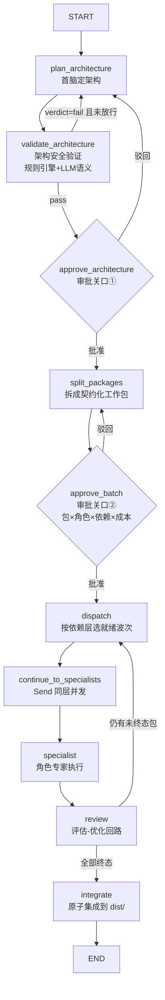

# agent-hive 功能分析报告与改进建议

> 分析对象：`Yingjiacheng7651010/agent-hive`（本地克隆，基于 `main` @ `51bdde1`）
> 分析方式：基于真实源码（`agent_hive/main.py`、`agent_hive/graph.py`、各模块、`hive_security/`、`hive_cost/`）与 README/文档交叉核对，非仅 README 转述。
> 文档分支：`docs/function-analysis`（本报告作为该分支首提交）

---

## 0. TL;DR（一句话结论）

agent-hive 是一个**契约驱动的多智能体编排框架**：一个「首脑（Chief）」统一统筹多个角色专家，流程为「定架构 → 架构安全验证 → 分包（契约化工作包）→ 验收集成」，并以 LangGraph 程序 + DSH 对话技能**双宿主**运行。其差异化不在于「多智能体」本身，而在于把**架构安全验证**与**成本预算/模型熔断**作为编排流程里的一等审批原语——这是主流 agent 框架（OpenAI Agents SDK / Claude Agent SDK / ADK / LangGraph）普遍缺失的维度。

---

## 1. 项目定位与双宿主

| 宿主 | 位置 | 运行方式 | 适用场景 |
|---|---|---|---|
| **LangGraph 程序** | `agent_hive/` | `python -m agent_hive run --goal "..."` | 独立/无头/CI 编排 |
| **DSH 技能** | `skill/` | 复制到 `~/.dsh/skills/agent-hive/`，对话触发 | 会话内由主模型当首脑 |

两者共用同一套契约：`skill/contracts.md` 由 `agent_hive/contract_spec.py` 单一事实源渲染生成（`scripts/generate_contracts.py --check` 做漂移检查）。设计借鉴 MetaGPT（看板/结构化工件）、CrewAI（评估返工）、LangGraph（supervisor/Send/interrupt）、OpenAI Agents SDK（guardrails）、Anthropic 多智能体模式。

---

## 2. 运行主流程（代码实证）

核心编排图见 `agent_hive/graph.py:245-285`，入口与审批关口见 `agent_hive/main.py:260-311`。



**节点职责（核对自 `graph.py` 导入与实现）**

- `validate_architecture`（`graph.py:70-126`）：规则引擎（确定性，纯标准库）+ 可选 LLM 语义验证双通道；`verdict=fail` 且未显式放行时，把整改建议汇总为驳回反馈自动回流重做架构，连续 `MAX_REJECT_COUNT` 次失败停止。
- `approve_architecture` / `approve_batch`（`graph.py:139-178`）：两个**契约级审批关口**，用 LangGraph `interrupt()` 暂停等人确认，resume 值用 `ApprovalDecision` 做 schema 校验；非法值一律按驳回处理（保守默认）。
- `dispatch` + `continue_to_specialists`（`graph.py:185-230`）：`scheduler.select_ready_packages` 选出当前就绪层（返工重派或下一依赖层），`Send` 同层真实并发，全部汇合后进入 `review`。
- `review` → `route_after_review`（`graph.py:233-242`）：评估-优化回路——验收不过带具体差距返工（≤3 轮后熔断），依赖下游阻塞传播，跨波归因记录警告且前序通过包冻结。
- `integrate`：通过包扁平合并到统一 `dist/`，同路径冲突拒绝覆盖，Python 静态编译 + `manifest.json` + staging 原子替换。

**关键 CLI 开关**（`main.py:329-386`）：`--yes`（无头自动批准）、`--tier T0/T1/T2`（权限分层：T2 顾问模式只出架构+提示词包不派发）、`--skip-arch-security` / `--allow-insecure-architecture`（均写审计）、`--security-policy-file`（策略 `fail_on_severity` 不允许低于 high）、`--allow-integration-checks`（显式允许集成阶段运行检查，默认 `shell=False`）。

---

## 3. 四大差异化能力（附证据位置）

| # | 能力 | 实现位置 | 说明 |
|---|---|---|---|
| ① | 契约一等公民 + 防漂移 | `agent_hive/contract_spec.py`、`contracts/workpackage.schema.json`、`scripts/contract_lint.py` | `PackageSpec`（Pydantic）→ 公开 JSON Schema → CLI 独立校验 → CI 漂移检查 |
| ② | 契约级 HITL 验收回流 | `agent_hive/graph.py`、`docs/card-async-hitl.md` | 人工审批只在「架构方案 + 批次表」两个契约级关口，非逐次工具审批；不通过自动带反馈返工 |
| ③ | 架构安全验证内嵌审批 | `hive_security/`、`benchmarks/security/` | 确定性规则引擎（幻觉引用/循环依赖/缺失安全控制/架构反模式），12 条威胁目录映射 CWE + OWASP LLM Top 10 2025，SARIF 输出可阻断 CI |
| ④ | 成本预算 + 模型熔断 | `hive_cost/`、`benchmarks/cost/` | `CostGate` 预算检查/降级链/阻断 + 重试/熔断/fallback 链，OTel 兼容 JSONL 导出，可被 Langfuse/LangSmith 消费 |

基准数字（`benchmarks/`，同输入两次运行逐字节一致）：
- 安全验证：129 样例，检出率 1.0000 / 误报率 0.0000 / verdict 准确率 1.0000；avg 延迟 0.08ms。
- 成本预算：100 任务 × 3–20 次调用，三档预算下完成率 100% → 64% → 52.2%。

---

## 4. 模块职责清单（`agent_hive/`）

| 模块 | 职责 |
|---|---|
| `main.py` | CLI 入口（`run`/`serve`）、输入守卫、安全策略加载、审计留痕、审批交互 |
| `graph.py` | LangGraph 编排图、审批关口、依赖层 fan-out、评估-优化回路 |
| `chief.py` | 首脑节点：架构/分包/评审/集成、看板、用量统计 |
| `scheduler.py` | 依赖图校验、ready 层、返工与阻塞传播（纯函数） |
| `specialists.py` | 专家节点：角色提示词 + 受限文件/命令工具（最小权限），`_safe_env()` 剔密 |
| `contract_spec.py` | 契约机器可读单一事实源 |
| `integration.py` | 统一 dist、冲突检测、manifest、原子集成、可选全局检查 |
| `arch_security*.py` | 架构安全验证（规则引擎 + LLM 语义，薄壳，事实源在 `hive_security`） |
| `cost_control.py` / `model_resilience.py` | 成本/韧性薄壳（事实源在 `hive_cost`） |
| `scope_auth.py` / `multi_tenancy.py` / `data_compliance.py` / `distributed_engine.py` | 权限分层、多租户、数据合规、分布式引擎 |
| `streaming.py` / `observability.py` / `async_hitl.py` | 流式、可观测、异步人工介入 |
| `tool_registry.py` / `prompt_management.py` / `memory.py` | 工具注册、提示词管理、记忆 |

独立零依赖包：`hive_security/`（架构安全验证）、`hive_cost/`（成本+熔断）。

---

## 5. 安全模型（亮点，建议作为卖点重点）

- **输入守卫**（`main.py:32-85`）：`_DANGER_PATTERNS` 覆盖文件系统破坏/系统操作/网络外联/危险编译等，命中需 `--allow-danger` 才放行；额外做 base64 编码命令检测。
- **策略防投毒**（`main.py:214-240`）：`--security-policy-file` 的 `fail_on_severity` 不允许放宽到低于 `high`，未知字段拒绝启动。
- **审计留痕**（`main.py:243-257`）：`--skip-arch-security` / `--allow-insecure-architecture` 任何为 true 都写入 `security-audit.md`，交付报告必须如实标注，不得粉饰为「验证通过」。
- **密钥隔离**：密钥只走本地 `.env`（gitignore）；专家子进程环境经 `_safe_env()` 自动剔除一切密钥变量（`specialists.py`），防经命令执行泄露。
- **最小权限**：专家工具受限文件/命令访问；默认禁用命令执行（`HIVE_ALLOW_SHELL=0`）。

---

## 6. 质量与验证信号

- 测试：README 称 490 passed（含架构安全验证与 golden 语料）；全局验收 `scripts/verify.py`（pytest + compileall + contract drift + contract lint + golden）。
- 可复现 benchmark：`benchmarks/security/run.py`、`benchmarks/cost/run.py` 无 random，同输入逐字节一致。
- **诚实的负向证据**（少见且加分）：README 明确披露 multi-agent 在 5 任务集上平均分 0.60 < 单 agent 1.00，且「逐任务存在 LLM 方差」，负向证据同样入库不修饰。

---

## 7. 工程师视角改进建议（按优先级）

**P0（正确性与健壮性）**
1. **修复本地 git 引用写入**：本仓库在 Windows 环境下 `git branch`/`git commit` 无法持久化分支 ref（`.lock` 原子 rename 被拦截），需排查 Git 版本/杀软/工作区权限，或改用 `core.refFormat`/WSL 内 git，否则团队协作与 CI 会反复踩坑。（注：本报告即绕过此问题，用 `commit-tree` + 按 SHA push 落地。）
2. **评估-优化回路的无限回流边界**：`graph.py` 依赖 `reject_count` 上限防止死循环，但返工只重派目标包、熔断向下游传播——建议补充「整体运行超时/成本硬上限」作为最后兜底（目前成本上限在 `hive_cost`，但未与编排回路强耦合）。
3. **架构安全验证对结构化输入强依赖**：`validate_architecture` 仅消费 `architecture_object`（`graph.py:84-91`），无结构化架构时直接 `pass` 跳过。建议在审批①强制要求结构化架构，避免「无输入即安全」的假阳性。

**P1（可维护性与解耦）**
4. **主框架与独立包耦合**：`pyproject.toml` 用 `tool.uv.sources` 把 `hive-security`/`hive-cost` 以 editable 路径引入，`agent_hive` 内的 `arch_security.py`/`cost_control.py`/`model_resilience.py` 是薄壳。建议明确「薄壳只做适配、事实源只在独立包」，并加 CI 断言防止逻辑回漂到薄壳。
5. **契约 schema 与代码单向同步**：`contract_spec.py` 是事实源，但 `skill/contracts.md` 也需同步。建议 CI 跑 `generate_contracts.py --check` 的同时，也校验 DSH 技能副本与框架契约一致。
6. **可观测性落盘标准化**：`cost.json`/`final_report.md` 落盘在 `agent_hive/runs/<run_id>/`，建议统一为 OTel 事件（已部分支持）并补充 trace_id 串联，便于多租户排障。

**P2（体验与采用）**
7. **DSH 技能与 LangGraph 程序行为对齐**：两者共用契约但调度语义可能漂移，建议补充双宿主一致性对照测试。
8. **断点续跑的密钥/环境恢复**：`--run-id` 续跑依赖 `checkpoint.db` 与产物目录，建议文档明确续跑所需的最小文件清单，避免「只给 run-id 起不来」。

---

## 8. 风险与局限（客观评估）

- **编排收益不稳定**：benchmark 诚实显示 multi-agent 小任务集弱于单 agent，且受 LLM 方差影响；框架价值在「中大型、需架构治理/安全/成本约束」的任务上更明显。
- **架构安全验证为确定性规则，非语义保证**：只消费结构化架构 JSON，不解析源码/依赖/供应链，不做动态渗透；`llm_enabled` 仅透传，成本为静态价格表估算（README 已声明未覆盖范围）。
- **未覆盖供应链/动态安全**：`hive-security` 不扫依赖、不调真实计费 API，`pass` 仅表示「给定输入+规则版本未命中」。
- **本地 git 工具链异常**：见 §7 P0-1，影响日常协作。

---

## 9. 快速验证命令

```bash
uv sync                                   # 安装依赖（含 hive-security/hive-cost editable）
uv run python -m agent_hive run --goal "做一个命令行待办事项管理器（Python）" --yes
uv run python -m agent_hive run --goal "..." --tier T2   # 顾问模式：只出架构+提示词包
uv run pytest -q                          # 回归测试（README：490 passed）
uv run python benchmarks/security/run.py  # 安全验证 benchmark
uv run python benchmarks/cost/run.py      # 成本预算 benchmark
uv run python scripts/agent_eval.py       # 单/多 agent 对比评测（真实模型）
```

---

*本报告由代码实证生成，引用行号基于分析时 `main` 分支快照（`51bdde1`）；若后续重构导致行号漂移，请以模块/函数名为准。*
